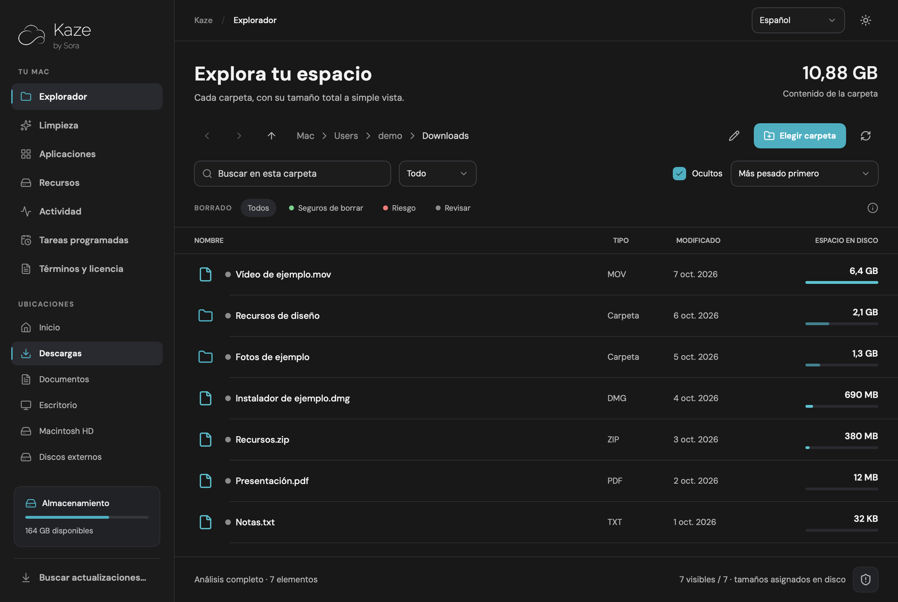
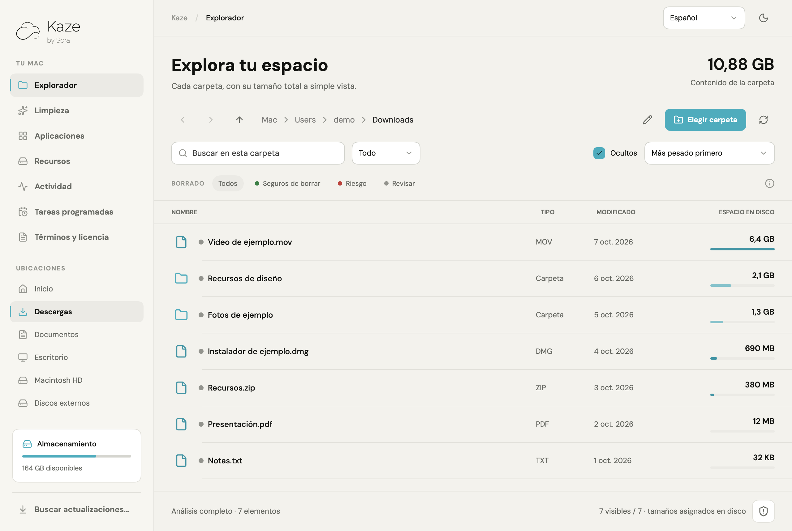
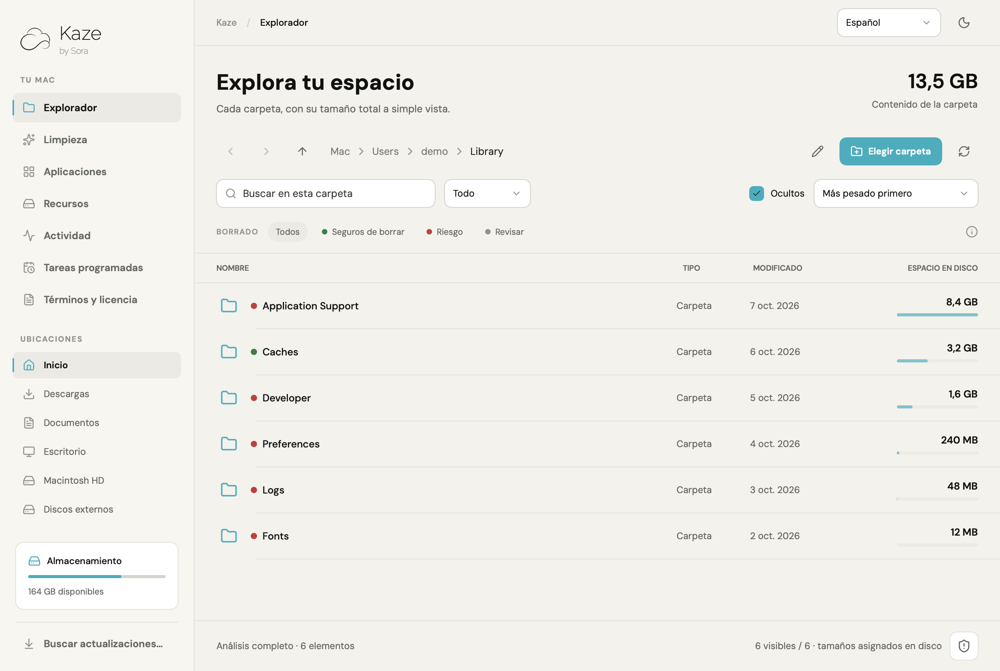
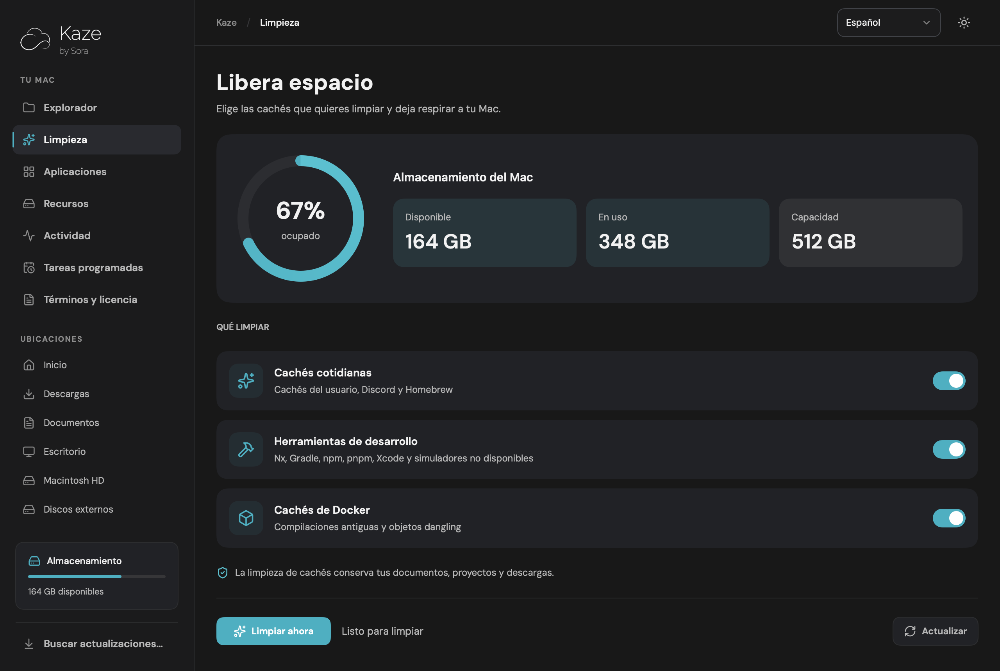
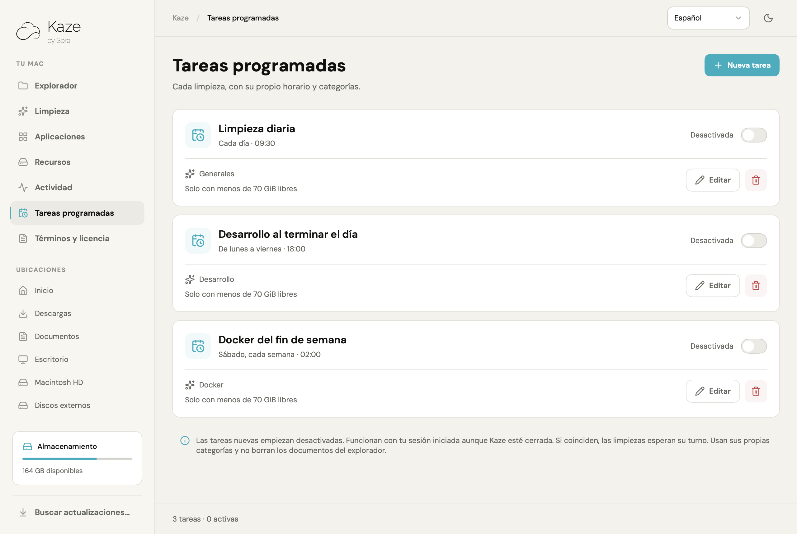
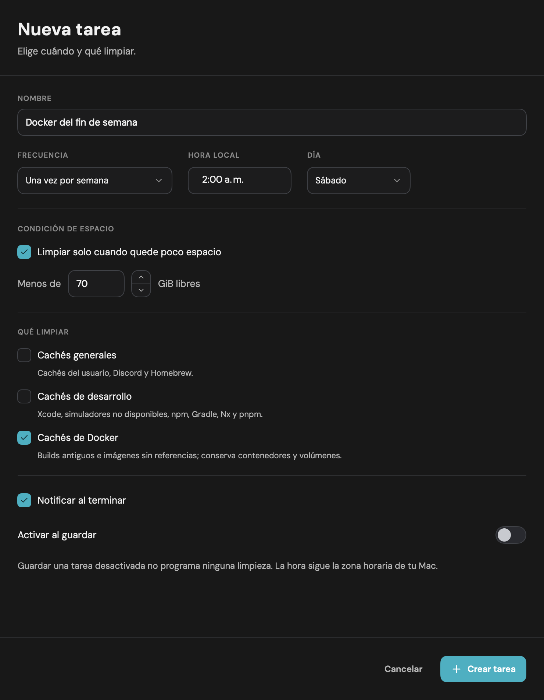

<div align="center">

# Kaze

**Dale aire a tu Mac.**

Explora tu almacenamiento, encuentra lo que ocupa espacio y organiza tus limpiezas.

Un producto de **Sora Agency** · macOS 13+ · SwiftUI · Licencia MIT

[English](README.md) · [Español](README.es.md)

[Instalar](#instalar) · [Compilar](#compilar) · [Capturas](#capturas) · [Contribuir](CONTRIBUTING.es.md)

</div>



## Qué puedes hacer

- **Explorar archivos y carpetas:** ver su espacio total sin entrar, incluidos
  elementos ocultos, paquetes de aplicaciones y discos externos accesibles.
- **Encontrar lo más pesado:** ordenar por tamaño, nombre, tipo o fecha y
  filtrar por nombre, archivos o carpetas.
- **Revisar antes de borrar:** distinguir cachés regenerables, ubicaciones
  sensibles y archivos que necesitan revisión con indicadores de color.
- **Limpiar cachés:** elegir entre cachés cotidianas, herramientas de desarrollo
  y cachés de Docker.
- **Gestionar aplicaciones y recursos:** revisar apps y datos asociados,
  recursos de Docker, simuladores y runtimes de Xcode.
- **Actualizaciones dentro de la app:** búsqueda al abrir, botón para buscar
  versiones y descargas firmadas con ventana para instalar y reiniciar.
- **Inglés y español:** interfaz, errores, notificaciones, términos y privacidad
  con un selector dentro de Kaze para cambiar al instante.
- **Programar varias limpiezas:** dar a cada tarea un nombre, horario,
  frecuencia, condición de espacio y categorías, y editarla o desactivarla
  por separado.

El preset de las **09:30 está desactivado**. Ninguna tarea nueva se activa
automáticamente. Las tareas activas funcionan con tu sesión iniciada aunque
la ventana de Kaze esté cerrada.

## Capturas

Todas las imágenes se generaron desde las vistas reales de la app con datos
ficticios. El usuario `demo`, los archivos, sus tamaños y las tareas son de
ejemplo; no son datos del equipo del desarrollador.

| Modo claro | Cachés y ubicaciones sensibles |
| --- | --- |
|  |  |

| Limpieza por categorías | Tareas independientes |
| --- | --- |
|  |  |

<details>
<summary>Formulario de una tarea</summary>



El formulario se muestra en un viewport ampliado para ver todas sus opciones.

</details>

## Instalar

Necesitas **macOS Ventura 13 o posterior**. Hay dos arquitecturas de paquetes:
`arm64` para Apple Silicon y `x86_64` para Intel. Puedes comprobar la tuya con
`uname -m` en Terminal. Docker, Homebrew y Xcode son opcionales: sus funciones
solo están disponibles si las herramientas correspondientes están instaladas.

1. Abre [Releases](https://github.com/Sora-Agency/kaze/releases) y descarga
   `Kaze-Mac-arm64.dmg` para Apple Silicon o `Kaze-Mac-x86_64.dmg` para Intel.
2. Abre el DMG y arrastra **Kaze** al acceso a **Aplicaciones**.
3. Expulsa el volumen **Kaze** desde Finder.
4. Abre **Kaze** desde `/Applications`.

`Source code (zip)` y `Source code (tar.gz)` son descargas del código fuente.
Para instalar la app, elige un archivo `.dmg`. Los borradores solo son visibles
para quienes mantienen el repositorio hasta que se publican.


Desde 1.1.0, Kaze busca versiones nuevas y ofrece descargar, instalar y
reiniciar desde la app. Usa **Buscar actualizaciones…** en el menú lateral o el menú
Kaze; puedes desactivar la búsqueda automática desde ese menú. Quienes usan
1.0.0 deben instalar 1.1.0 una vez para incorporar el updater. Las siguientes
actualizaciones conservan las preferencias y las tareas programadas.

Si actualizas una instalación, cierra Kaze antes de reemplazarla. Si tenías una
copia en `~/Applications`, conserva una sola copia para evitar abrir la anterior.

Los paquetes generados por este proyecto tienen firma ad hoc y **no están
notarizados por Apple**. macOS puede bloquear su primera apertura; autoriza
Kaze desde **Ajustes del Sistema → Privacidad y seguridad → Abrir igualmente**
si confías en el origen. Consulta
[las instrucciones de Apple para abrir apps descargadas](https://support.apple.com/es-es/102445).

Para analizar ubicaciones protegidas, usa el botón de permisos de Kaze y
concede **Acceso total al disco**. La app respeta las protecciones de macOS;
un tamaño parcial no se presenta como un análisis completo.

También puedes descargar el ZIP de tu arquitectura, descomprimirlo completo y
abrir `Instalar.command` con clic derecho → **Abrir**. Esta alternativa instala
en `~/Applications`, conserva tus preferencias y tareas y respalda la versión
anterior en `~/Library/Application Support/Kaze/Backups`.
Si instalaste desde el DMG, desactiva tus tareas programadas en Kaze, cierra la
app y muévela a la Papelera desde Aplicaciones. Si usaste el instalador del ZIP,
ejecuta `Desinstalar.command` para retirar esa copia y los agentes programados.
Los registros y respaldos se conservan.

### Idioma

Usa el selector de idioma de la barra superior, junto al botón de apariencia,
para elegir **Español** o **English**. La interfaz cambia al instante y la
preferencia se guarda para las próximas aperturas y las notificaciones de tareas
programadas. Hasta que elijas, Kaze sigue el idioma de macOS, con inglés como
alternativa. Los nombres de tareas guardadas y de tus archivos se conservan.
La licencia MIT y las licencias de terceros mantienen su texto original.

## Compilar

Necesitas Python 3, las herramientas de línea de comandos de Xcode y un compilador Swift
compatible con el SDK de macOS 13 o posterior. Si todavía no tienes las
herramientas, instálalas con:

```sh
xcode-select --install
```

Desde la raíz del repositorio o del ZIP de código fuente:

```sh
scripts/test.sh
scripts/build.sh
open package/Kaze.app
```

La primera compilación descarga Sparkle 2.10.0 desde su release oficial y
verifica el SHA-256 fijado; las siguientes usan la caché local. Fuentes, logo e
iconos se incluyen en el proyecto. No necesitas Node.js, npm ni un `.xcodeproj`.
El script compila para la arquitectura del Mac que lo ejecuta.

| Salida | Contenido |
| --- | --- |
| `package/Kaze.app` | App compilada, lista para abrir |
| `build/Kaze-Mac-<arquitectura>.dmg` | Instalación arrastrando Kaze a Aplicaciones |
| `build/Kaze-Mac-<arquitectura>.zip` | App, instalador, desinstalador y avisos legales |
| `build/Kaze-Source.zip` | Código, documentación, capturas y archivos de GitHub |
| `build/Kaze-SHA256-<arquitectura>.txt` | SHA-256 del DMG, ZIP binario y código fuente |

Para instalar arrastrando la app:

```sh
open "build/Kaze-Mac-$(uname -m).dmg"
```

Para instalar la compilación en tu usuario con respaldo automático:

```sh
package/Instalar.command
```

Consulta [la arquitectura](ARCHITECTURE.md), [la guía de contribución](CONTRIBUTING.es.md)
y [la guía de publicación](docs/PUBLISHING.es.md) para trabajar en el proyecto.

Para preparar una release, actualiza la versión y las notas y sube un tag como
`v1.1.0`. GitHub Actions verifica Apple Silicon e Intel y crea un borrador con
los DMGs, ZIPs, fuentes, feeds firmadas y hashes. La publicación se confirma desde **Releases**.

## Qué significan los tamaños y los colores

Kaze mide **espacio asignado en disco**, sin recorrer destinos de enlaces
simbólicos ni contar dos veces los enlaces duros dentro de un mismo análisis.
Un `≥` identifica una medición parcial o en progreso. APFS, bloques compartidos
y archivos en la nube pueden hacer que ese tamaño difiera del espacio que se
recuperaría al borrar un elemento.

| Indicador | Interpretación |
| --- | --- |
| Verde | Cachés o compilaciones conocidas que pueden regenerarse |
| Rojo | Sistema, aplicaciones, configuración o datos sensibles |
| Gris | Requiere revisar su contenido y uso |

Los indicadores orientan la revisión; no garantizan que un archivo sea
prescindible. El explorador no borra archivos. Las apps y sus datos seleccionados
se mueven a la Papelera, que Kaze no vacía automáticamente. Los recursos de
Docker y Xcode se eliminan con sus herramientas y pueden borrarse permanentemente
tras la confirmación. Revisa tus selecciones y conserva copias de seguridad.

## Privacidad

Kaze funciona localmente, sin cuentas, publicidad ni telemetría de Sora.
Los listados del explorador permanecen en memoria. Las preferencias, tareas
y registros se guardan en el Mac. La búsqueda de actualizaciones consulta GitHub
sin enviar tus archivos ni resultados del análisis. Herramientas externas como
Docker y Homebrew mantienen su propio comportamiento. Consulta [PRIVACY.txt](PRIVACY.txt).

Para regenerar las capturas públicas con datos de ejemplo:

```sh
scripts/screenshots.sh
```

El generador usa un almacenamiento ficticio y no lee registros ni inventarios
de aplicaciones del equipo. Las imágenes en español se guardan en `docs/images` y las de inglés en
`docs/images/en`.

## Licencia y créditos

El código de Kaze se distribuye bajo [licencia MIT](LICENSE), a nombre de
**Sora Agency y sus colaboradores**. Se ofrece «tal cual», sin garantías;
la responsabilidad se limita en la medida permitida por la ley. Los
[términos de uso](TERMS.txt) no restringen los derechos otorgados por MIT.

Lucide conserva su licencia ISC y los avisos de Feather. DM Sans y Raleway
conservan sus licencias SIL Open Font License. El nombre y el logo de Sora
identifican el producto; la licencia del código no concede derechos de marca.
Consulta [los avisos de terceros](THIRD_PARTY_NOTICES.txt).
