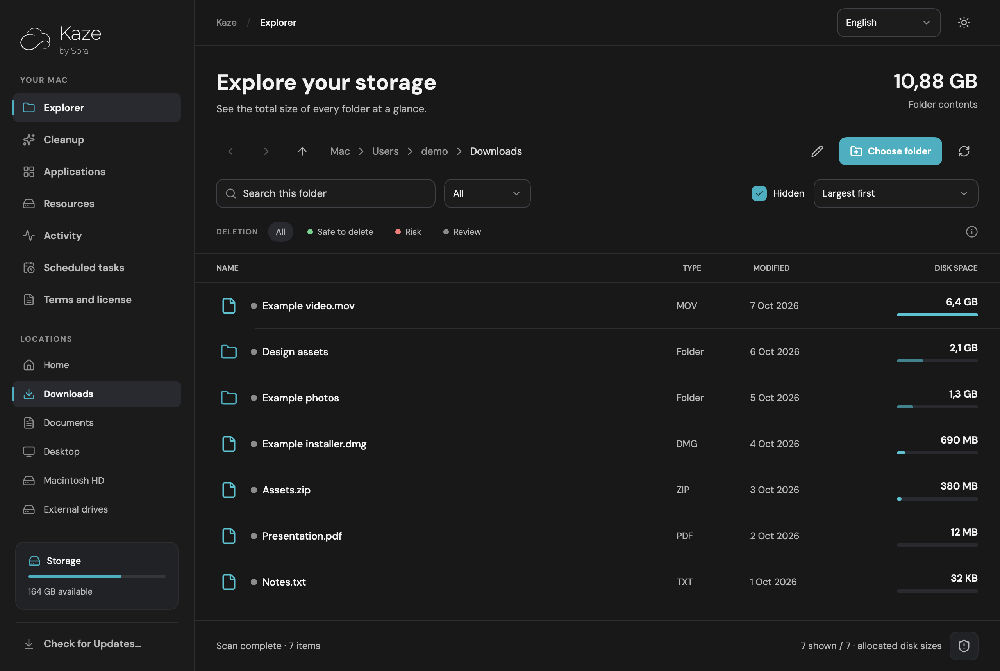
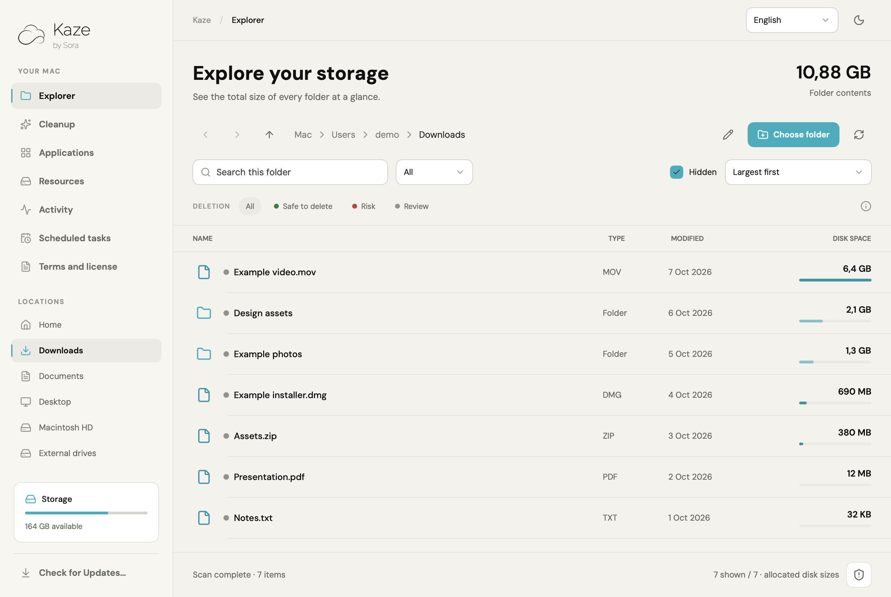
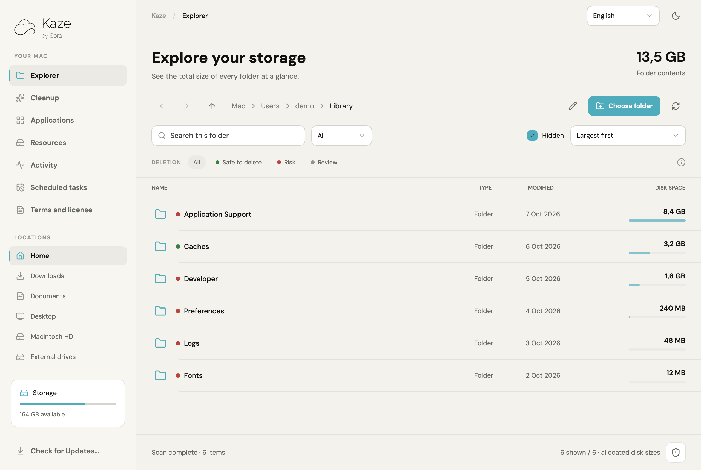
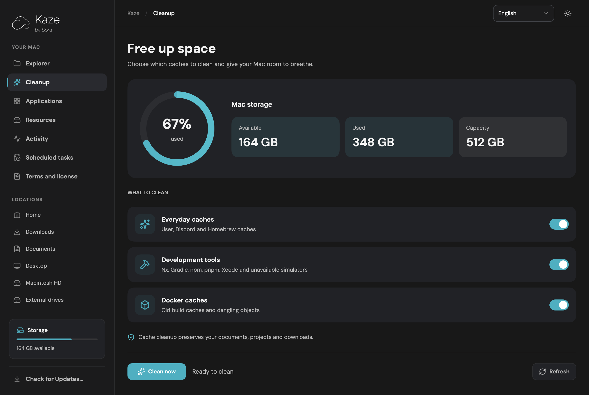
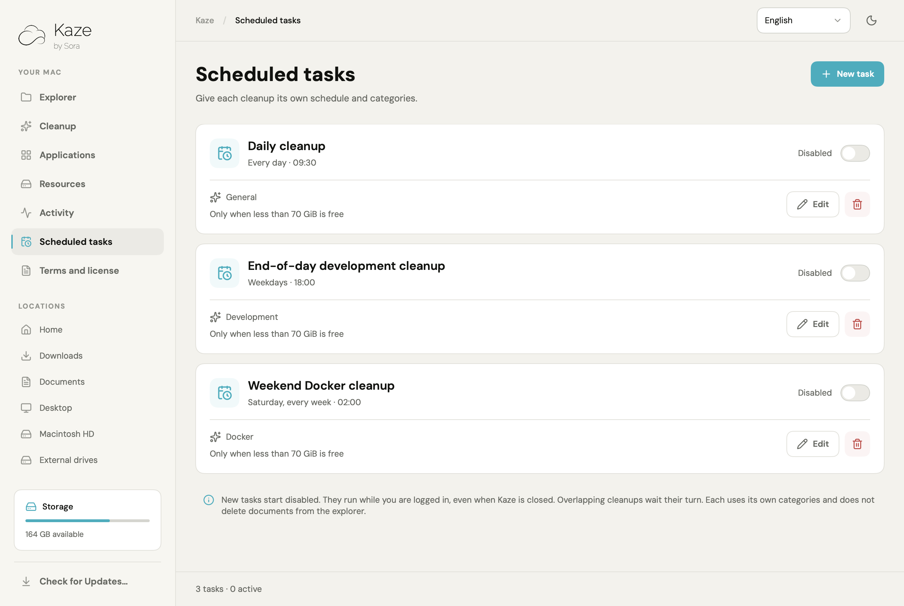
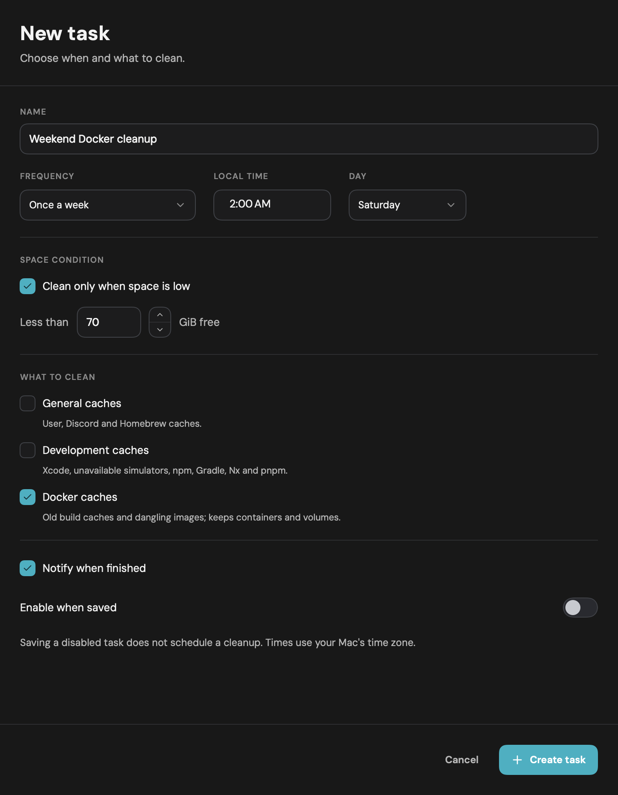
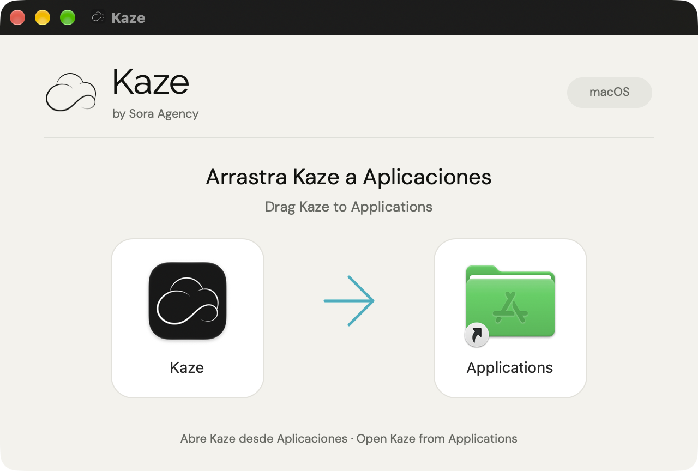

<div align="center">

# Kaze

**Give your Mac room to breathe.**

Explore your storage, find what takes up space and organize your cleanups.

A product by **Sora Agency** · macOS 13+ · SwiftUI · MIT License

[English](README.md) · [Español](README.es.md)

[Install](#install) · [Build](#build) · [Screenshots](#screenshots) · [Contribute](CONTRIBUTING.md)

</div>



## Features

- **Explore files and folders:** see total folder sizes without opening them,
  including hidden items, app bundles and accessible external drives.
- **Find the largest items:** sort by size, name, type or date and filter by
  name, files or folders.
- **Review before deleting:** colored indicators distinguish regenerable
  caches, sensitive locations and files that need a closer look.
- **Clean caches:** choose everyday caches, development tools and Docker caches.
- **Manage apps and resources:** inspect apps and related data, Docker resources,
  and Xcode simulators and runtimes.
- **Schedule multiple cleanups:** give each task its own name, time, frequency,
  free-space condition and categories; edit or disable each independently.
- **In-app updates:** checks on launch, a Check for Updates button and signed
  downloads with an install-and-relaunch window. Automatic checks can be disabled.
- **English and Spanish:** the interface, errors, cleanup notifications and legal
  documents can be switched instantly from the language selector inside Kaze.

The **09:30 preset is disabled**. New tasks never activate automatically.
Active tasks run while you are logged in, even with the Kaze window closed.

## Screenshots

All images use the app's real views with fictional data. The `demo` user, files,
sizes and tasks are examples, not data from the developer's computer.

| Light mode | Caches and sensitive locations |
| --- | --- |
|  |  |

| Cleanup categories | Independent tasks |
| --- | --- |
|  |  |

<details>
<summary>Task editor</summary>



This form uses a taller viewport to show all its options.

</details>

## Install

Requires **macOS Ventura 13 or later**. Packages are available for `arm64`
(Apple Silicon) and `x86_64` (Intel). Run `uname -m` in Terminal to check yours.
Docker, Homebrew and Xcode are optional; their integrations require the
corresponding tools to be installed.

1. Open [Releases](https://github.com/Sora-Agency/kaze/releases) and download
   `Kaze-Mac-arm64.dmg` for Apple Silicon or `Kaze-Mac-x86_64.dmg` for Intel.
2. Open the DMG and drag **Kaze** onto **Applications**.
3. Eject the **Kaze** volume in Finder.
4. Open **Kaze** from `/Applications`.

`Source code (zip)` and `Source code (tar.gz)` are source downloads, not installers.
Release drafts are visible to repository maintainers until published.



Starting with 1.1.0, Kaze checks for updates and offers download, installation
and relaunch from the app. Use **Check for Updates…** in the sidebar or Kaze menu;
automatic checks can be disabled from the same menu. Users of 1.0.0 must install
1.1.0 once to get the updater. Updates preserve preferences and scheduled tasks.

Close Kaze before manually replacing an existing installation. If you also have a copy
in `~/Applications`, keep a single copy to avoid opening the old one.

Packages built by this project are ad hoc signed and **not notarized by Apple**.
macOS may block the first launch. If you trust the source, allow Kaze under
**System Settings → Privacy & Security → Open Anyway**. See
[Apple's instructions for opening downloaded apps](https://support.apple.com/en-us/102445).

For protected locations, use Kaze's permissions button to grant **Full Disk
Access**. The app respects macOS protections; partial sizes are marked as partial.

Alternatively, download and extract the entire ZIP for your architecture,
then right-click `Instalar.command` → **Open**. It installs in `~/Applications`,
preserves preferences and tasks, and backs up the previous version under
`~/Library/Application Support/Kaze/Backups`.

To uninstall a DMG installation, disable scheduled tasks in Kaze, close the app
and move it from Applications to the Trash. For a ZIP installation, run
`Desinstalar.command` to remove that copy and its scheduled agents.
Logs and backups are retained.

### Language

Use the language selector in the top bar, next to the appearance button, to choose
**Español** or **English**. The interface updates immediately, and your choice is
saved for future launches and scheduled cleanup notifications. Before you choose,
Kaze follows macOS language preferences, with English as the fallback. Existing
task names and your file and folder names stay as you entered them. The MIT
license and third-party license texts retain their original wording.

## Build

Requires Python 3, Xcode Command Line Tools and a Swift compiler compatible
with the macOS 13 SDK or later. To install the tools:

```sh
xcode-select --install
```

From the repository root or extracted source ZIP:

```sh
scripts/test.sh
scripts/build.sh
open package/Kaze.app
```

The first build downloads Sparkle 2.10.0 from its official release and verifies
its pinned SHA-256. Later builds use the local cache. Fonts, logo and icons are bundled.
Node.js, npm and an `.xcodeproj` are not required. The build targets the
architecture of the Mac running it.

| Output | Contents |
| --- | --- |
| `package/Kaze.app` | Compiled app, ready to open |
| `build/Kaze-Mac-<architecture>.dmg` | Drag-to-Applications installer |
| `build/Kaze-Mac-<architecture>.zip` | App, installer, uninstaller and legal notices |
| `build/Kaze-Source.zip` | Source, documentation, screenshots and GitHub files |
| `build/Kaze-SHA256-<architecture>.txt` | SHA-256 hashes of the DMG, binary ZIP and source |

Open the drag-and-drop installer:

```sh
open "build/Kaze-Mac-$(uname -m).dmg"
```

Or install for your user with automatic backup:

```sh
package/Instalar.command
```

See the [architecture](ARCHITECTURE.md), [contribution guide](CONTRIBUTING.md)
and [publishing guide](docs/PUBLISHING.md).

To prepare a release, update the version and release notes, then push a tag such
as `v1.1.0`. GitHub Actions checks Apple Silicon and Intel and creates a draft
with DMGs, ZIPs, source, signed update feeds and hashes. Review and publish it from **Releases**.

## Sizes and indicators

Kaze measures **allocated disk space**, without following symbolic-link targets
or counting hard links twice within one scan. A `≥` marks a partial or ongoing
measurement. APFS shared blocks and cloud files can make this differ from the
space recovered after deletion.

| Indicator | Meaning |
| --- | --- |
| Green | Known caches or build files that can be regenerated |
| Red | System components, apps, settings or sensitive data |
| Gray | Review the content and how it is used |

Indicators guide your review; they do not guarantee that a file is disposable.
The explorer does not delete files. Selected apps and related data move to the
Trash, which Kaze never empties automatically. Docker and Xcode resources use
those tools and may be permanently deleted after confirmation. Review your
selection and keep backups.

## Privacy

Kaze works locally, with no accounts, advertising or Sora telemetry. Explorer
results remain in memory. Preferences, tasks and logs are stored on your Mac;
update checks connect to GitHub without sending file lists or scan results;
external tools such as Docker and Homebrew retain their own behavior. See the
[privacy notice](src/Localization/en.lproj/PRIVACY.txt).

Regenerate public screenshots using example data:

```sh
scripts/screenshots.sh
```

The generator uses fictional storage and does not read the computer's logs or
app inventories. Spanish images are saved in `docs/images`; English images
in `docs/images/en`.

## License and credits

Kaze's code is distributed under the [MIT License](LICENSE), in the name of
**Sora Agency and contributors**. It is provided “as is”, without warranties;
liability is limited to the extent permitted by law. The
[terms of use](src/Localization/en.lproj/TERMS.txt) do not restrict MIT rights.

Lucide retains its ISC license and Feather notices. DM Sans and Raleway retain
their SIL Open Font Licenses. The Sora name and logo identify the product;
the code license does not grant trademark rights. See the
[third-party notices](THIRD_PARTY_NOTICES.txt).
